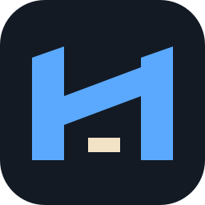
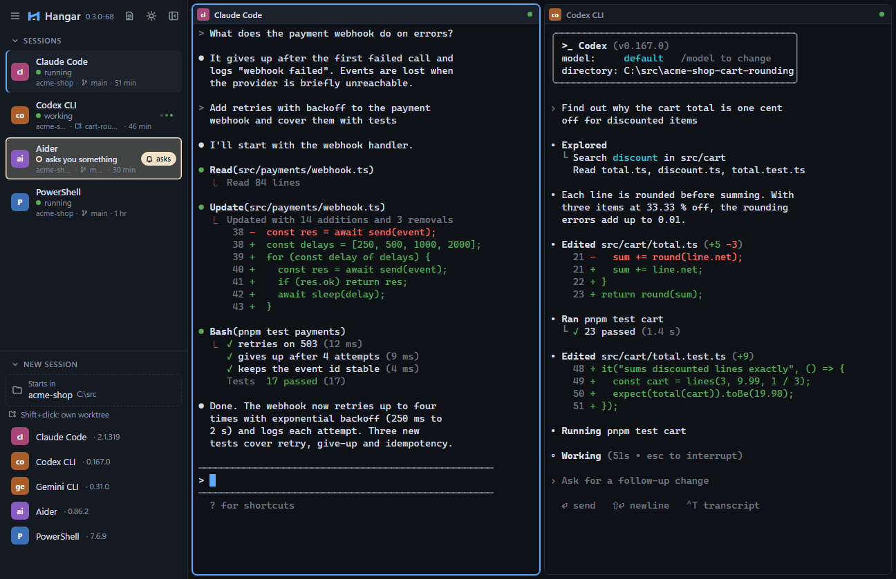

<p align="center">
  
</p>

<h1 align="center">Hangar</h1>

<p align="center"><strong>One window for all your terminal sessions and AI coding agents.</strong></p>

Hangar is a desktop app that runs Claude Code, Codex CLI, Gemini CLI, Aider and any other command-line
tool side by side. A sidebar switches between sessions while every session keeps running in the
background, with its full scrollback.

<picture>
  <source media="(prefers-color-scheme: light)" srcset="docs/images/hangar-light.png">
  
</picture>

[](https://github.com/feoren/hangar/actions/workflows/ci.yml)
[](https://github.com/feoren/hangar/releases/latest)
[](LICENSE)

## Features

- **All your agents in one window.** Claude Code, Codex CLI, Gemini CLI, Aider and 18 more are
  found automatically. Every session keeps running while you look at another one.
- **Never miss a question.** When an agent waits for you, Hangar shows it clearly and can play a
  sound or send a notification. `Ctrl+Shift+A` jumps to the next waiting session.
- **Two or four at once.** Show several sessions side by side and arrange them by dragging.
- **Agents that don't get in each other's way.** Give a session its own copy of the project, see
  what it changed, and get a warning when two sessions touch the same file.
- **Notes next to the terminal.** Quick notes with checklists (`Ctrl+Shift+N`), and you can send a
  note to an agent with one click.
- **Picks up where you left off.** After a restart your sessions come back, with their history.
- **Updates with one click.** For Hangar itself and for your agents.
- **Teams (coming soon).** See what your teammates' agents are working on, end-to-end encrypted.
- **Light and dark, 12 languages,** and shortcuts that never take keys away from your programs.

## Platforms

| Platform                    | Status                         |
| --------------------------- | ------------------------------ |
| Windows 10 1809+ / 11 (x64) | supported, installer available |
| macOS 13+                   | planned                        |
| Linux x64 (X11, Wayland)    | planned                        |

The code base already builds and passes its tests on all three systems in CI; installers and
updates for macOS and Linux follow once they have been tested by hand.

## Install

1. Download **`Hangar-Setup.exe`** from the [latest release](https://github.com/feoren/hangar/releases/latest).
2. Run it. It installs for the current user, without administrator rights.

Until the installer is code-signed, Windows SmartScreen may warn the first time you run it; choose
**More info → Run anyway**.

## Updates

Hangar updates itself. Shortly after start and every 6 hours it checks the latest GitHub release.
When a newer version exists, the sidebar shows **Update x.y.z available · Install**. One click downloads
it, verifies its signature and installs it; Hangar asks before it restarts, because running sessions
end. You can also check by hand under **Help → Check for updates**.

Every update is signed with the project's private key, and Hangar refuses any file whose signature
does not match the public key built into the app.

## Build from source

Requirements: [Rust](https://rustup.rs) (stable), [Node.js](https://nodejs.org) 22+,
[pnpm](https://pnpm.io), and the [Tauri 2 prerequisites](https://tauri.app/start/prerequisites/) for
your platform.

```sh
pnpm install
pnpm tauri dev      # run in development mode
pnpm tauri build    # build an installer
```

The check suite (everything must pass before a commit):

```sh
cargo fmt --manifest-path src-tauri/Cargo.toml --check
cargo clippy --manifest-path src-tauri/Cargo.toml --all-targets -- -D warnings
cargo test --manifest-path src-tauri/Cargo.toml
cargo fmt --manifest-path crates/hangar-team-protocol/Cargo.toml --check
cargo clippy --manifest-path crates/hangar-team-protocol/Cargo.toml --all-targets -- -D warnings
cargo test --manifest-path crates/hangar-team-protocol/Cargo.toml
cargo fmt --manifest-path crates/hangar-team-crypto/Cargo.toml --check
cargo clippy --manifest-path crates/hangar-team-crypto/Cargo.toml --all-targets -- -D warnings
cargo test --manifest-path crates/hangar-team-crypto/Cargo.toml
python3 crates/hangar-team-protocol/test_vectors.py  # Windows: py -3
python3 crates/hangar-team-crypto/test_vectors.py
pnpm format:check && pnpm lint && pnpm test && pnpm build
```

## Profiles

Custom programs can be edited under **Settings > Terminals & agents**, with API keys kept in the
system keychain. They are stored in `profiles.toml` in the app's config folder; **Open profile
file** in the same place opens it in your editor (and creates it if it is missing); **Help >
About Hangar** shows the exact path.

```toml
[[profile]]
id = "mytool"
name = "My tool"
command = "mytool"        # looked up in PATH, or a full path; no shell syntax
args = ["--flag"]
```

A profile with the `id` of a catalog agent (for example `claude`) overrides how that agent is
launched. The generated file explains every field. After saving, switch back
to the Hangar window or choose **Reload profiles**; running sessions are not affected. Never put
secrets in it.

## Architecture

Tauri 2 with a Rust backend that owns every process (PTY via `portable-pty`, process trees via Job
Objects on Windows) and a React + TypeScript frontend that only renders. The frontend can call only
explicitly allowed backend commands. Design decisions are recorded as ADRs in
[`docs/wiki`](docs/wiki/index.md).

## Contributing

See [CONTRIBUTING.md](CONTRIBUTING.md). Security issues: see [SECURITY.md](SECURITY.md).

## License

[MIT](LICENSE)
