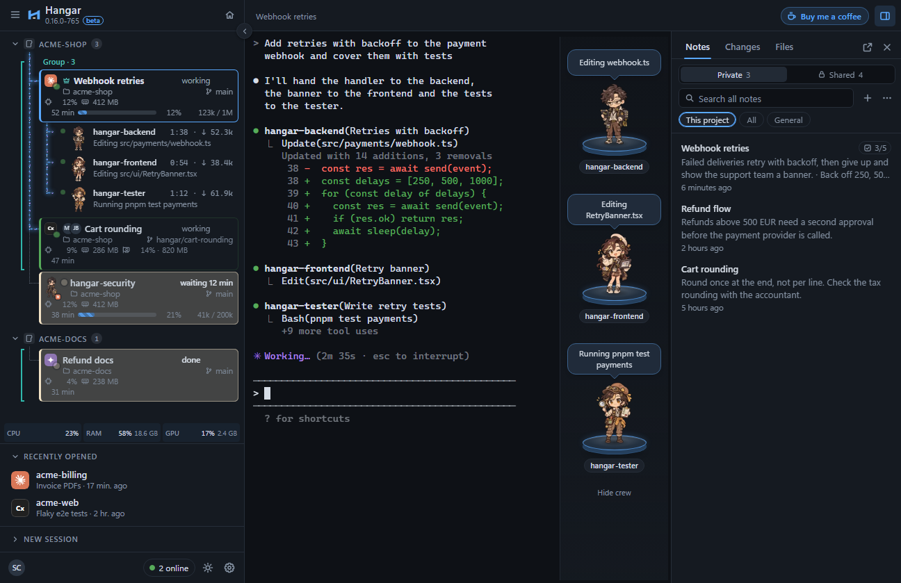
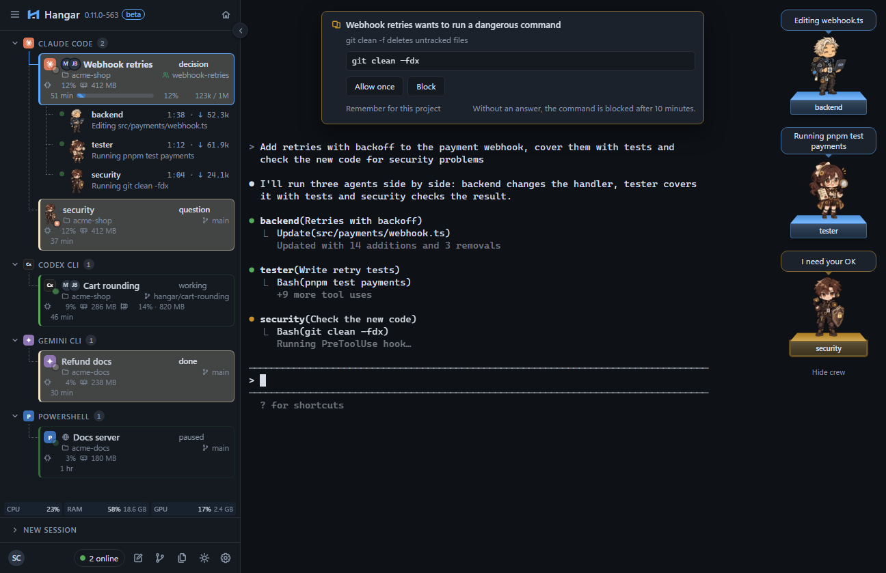
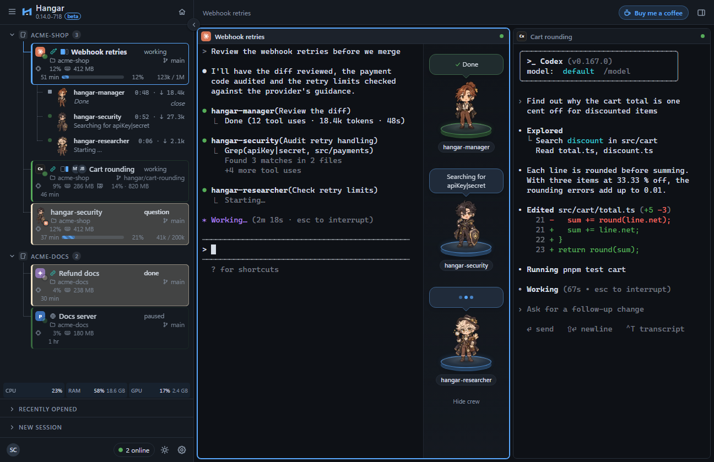
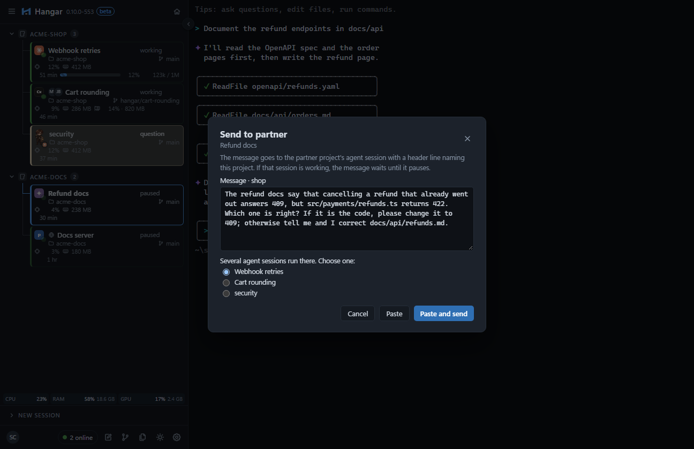
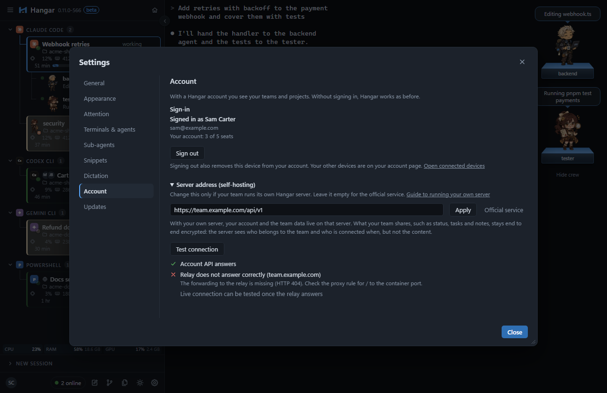
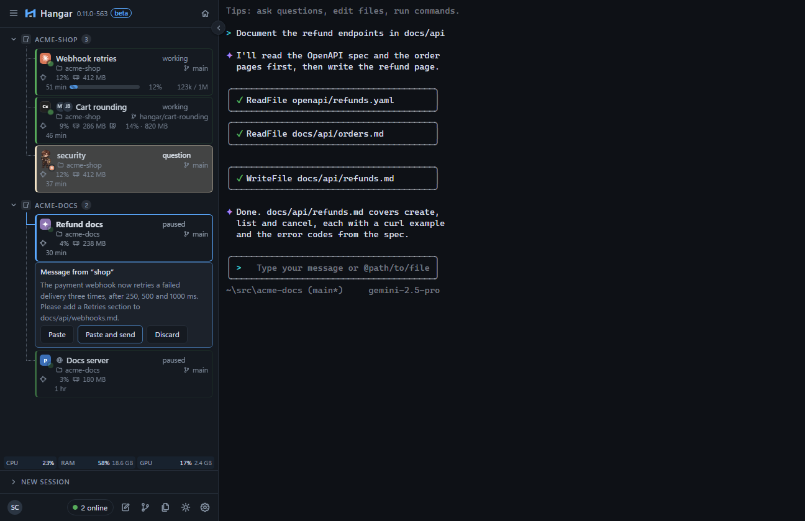
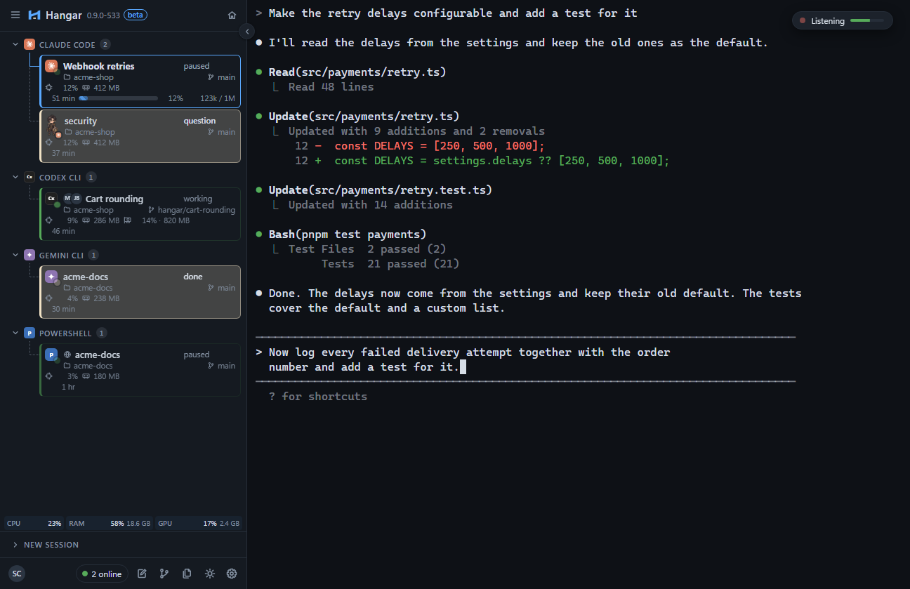

<p align="center">
  
</p>

<h1 align="center">Hangar</h1>

<p align="center"><strong>Run AI coding agents as a team.</strong></p>

<p align="center">
  <a href="https://hangar.feoren.com">Website</a> ·
  <a href="https://github.com/feoren/hangar/releases/latest">Download</a> ·
  <a href="#getting-started">Getting started</a> ·
  <a href="#teams-and-privacy">Teams and privacy</a> ·
  <a href="CONTRIBUTING.md">Contributing</a>
</p>

<p align="center">
  <a href="https://github.com/feoren/hangar/actions/workflows/ci.yml"></a>
  <a href="https://github.com/feoren/hangar/releases/latest"></a>
  <a href="LICENSE"></a>
</p>

AI coding agents are fast. Put a whole team of people behind them and the hard part is no longer
writing code, it is knowing who changes what: two agents rewrite the same file, a task gets done
twice, a question waits unseen in some terminal. **Hangar is the shared control room for that.**

Every teammate runs Claude Code, Codex CLI, Gemini CLI, Aider or any other command-line tool in
Hangar on their own machine. Hangar shows the whole team, live, which agent works on which task and
which files it changes, lets people reserve tasks, and warns before two agents collide. Everything
shared with the team is end-to-end encrypted, and Hangar works just as well for a single person.

Hangar brings no model and makes no API calls of its own: it runs the tools you already use, with
your own accounts, on your own machine. The desktop app is open source under the MIT license.

<picture>
  <source media="(prefers-color-scheme: light)" srcset="docs/images/hangar-light.png">
  
</picture>

## Features

### Sessions and agents

- **Every agent in one window.** Claude Code, Codex CLI, Gemini CLI, Aider and 18 more command-line
  tools are detected automatically and start with one click, each with its own icon in one
  consistent style. PowerShell, Command Prompt, WSL and any other command work the same way.
- **Sessions that keep running.** Every session runs in the background while you work in another
  one, and comes back with its history after Hangar restarts. The house button in the sidebar puts
  them aside and shows a calm home view: one card per repository with its sessions, open changes,
  newest commits and dev servers, and a calendar of your commits over the last year.
- **Sessions you recognize.** The sidebar groups sessions by program or by project folder, and an
  agent session takes its name from your first prompt, so several sessions in one project stay
  apart. Each row shows its state, folder and branch, and its CPU, memory and GPU use in aligned
  columns. Hovering a row shows that session's last lines in their colors without switching to it.
- **A terminal that feels like an editor.** A click in the prompt line moves the cursor there without
  taking the agent's grey suggestion, Backspace or Delete removes marked text, also across the rows
  of a long, wrapped prompt, and Shift+Enter starts a new line in an agent's prompt instead of
  sending it. Your last prompt stays visible above an agent's terminal; a click jumps to the line
  you sent it from. Web addresses and existing files and folders in the output open with one click;
  with Shift held, each folder of a path opens on its own.
- **Dictation on your own computer.** Hold Ctrl+Shift+Space, speak and let go: the text lands in the
  prompt of the active session. Speech is recognized locally, nothing is sent anywhere. Turn it on
  under _Settings > Dictation_.
- **One instruction file for all agents.** Write your rules once in HANGAR.md and Hangar hands them
  to every agent that accepts extra instructions (Claude Code, Codex CLI, Aider), without touching
  your repository. An agent started in a fresh worktree first checks for new upstream commits and
  asks before pulling them.
- **Agent commands in one click.** The session menu and quick access send an agent's own commands
  such as `/compact`, `/clear` or `/model`, and commands that start over ask first. Add your own
  commands to a profile.
- **Queue the next message.** Write your next instruction while an agent works; Hangar sends it as
  soon as the agent is done and holds it back while the agent asks you something.
- **Hand over to another agent.** "Hand over to ..." in the session menu starts another installed
  agent in the same folder and inserts the last request, the changed files and your notes.
- **Partner projects.** Link projects that belong together, such as an app and its website, on
  their project card. "Send to partner" in the session menu pastes a message into the partner
  project's agent session, with a header line naming the sender, and waits until that agent pauses.
- **Agents message each other.** Agents in linked projects can send with `hangar-send <partner>
<text>`. Nothing is pasted on its own: the message waits under the partner's session row until you
  choose Paste, Paste and send or Discard.
- **Side by side.** Show two, three or four sessions at once, arrange them by dragging and resize
  them by dragging the lines between them.
- **Quick access.** Ctrl+Shift+P finds sessions, programs, files, recent commits, settings and every
  menu command; Ctrl+Shift+S searches the output of all sessions and Ctrl+Shift+M shows them all as
  live tiles. No shortcut collides with the shells and agents themselves.
- **Workspace templates.** Save the running sessions as a template and start the whole set again
  with one click.
- **Profiles as files.** Programs, arguments, working folders and environment variables are plain
  configuration. Secret variables are stored in the operating system's credential store, never in
  a file.

### Staying in control

- **Never miss a question.** The sidebar shows at a glance which agent is working, which one is done
  and which one asks you something, with a colored edge and a small icon on every row. An optional
  sound, a desktop notification, a push to your phone (ntfy or Pushover) and a badge on the taskbar
  icon add to it, all of them quiet during the hours you choose.
- **What changed when it is done.** When an agent finishes, a short notice names how many files it
  changed and opens them in one click. A local dev server an agent starts shows as a globe on its
  row that opens it in the browser.
- **Load at a glance.** A one-row bar shows the machine's CPU, memory and GPU load as small live
  graphs with the memory in use, and every session row shows its own CPU, memory and, when it uses
  the GPU, GPU load and memory (GPU numbers on Windows); a mark flags a session that keeps a whole
  core busy or holds a lot of memory.
- **Context at a glance.** Claude Code sessions show how full their context window is right in
  their row, for example `12 % · 123k / 1M`. From 80 % a compact button on the row sends the
  agent's compact command.
- **A hint when nothing moves.** When a working agent has shown nothing new for a while, its row
  says so quietly, and the session menu offers its last lines and Ctrl+C. No sound, no alarm.
- **Your colors for every state.** Working, done, waiting and paused each get their own color, pulse
  strength and pulse duration, previewed live in the settings.
- **Costs at a glance.** Tokens and estimated costs per session and per day for Claude Code, in the
  peek and under _View > Costs_, with an optional daily budget that tells you once when it is reached.
- **Watch sub-agents work.** The sub-agents of a Claude Code session appear as a tree below it, each
  with what it does right now, its run time and its tokens. One click shows a sub-agent beside the
  terminal the way Claude Code itself does, with recognizable keys and passwords masked; drag the
  line between them to give either side more room, and close finished ones with one click.
- **Your crew beside the terminal.** Running sub-agents stand as figures in a column next to the
  agent's terminal, each on a plinth with its name whose color shows its state (working, waiting
  for you, done), and a speech bubble says what it is doing right now, such as "Reading parser.rs".
  A narrow window shows a strip of faces instead; the session menu shows or hides the crew.

### Sub-agents

- **Your sub-agents in one place.** _Settings > Sub-agents_ lists your Claude Code agents from
  `~/.claude/agents` and your projects, and Codex CLI's own agent files. Add a new one by pasting it
  or from a file; Hangar never replaces a file unasked.
- **A figure for every agent.** Each sub-agent wears a whole figure: one of 31 bundled ones or
  your own image, also animated. A session started as a sub-agent wears it in the sidebar, and the
  crew column shows it while the sub-agent works.
- **Start as an agent.** The arrow beside Claude Code starts a session as one of your sub-agents
  (`claude --agent`), also from quick access.
- **Models per agent and per program.** Pick the model of each sub-agent (Opus, Sonnet, Haiku, Fable
  or a model id for Claude Code; a model and reasoning effort for Codex CLI) and a default model for
  all sub-agents of a program, which Hangar sets for every session it starts.
- **The same crew in every agent.** Hangar provides your Claude Code sub-agents to Codex CLI as well,
  so both work with the same team. A file of yours with the same name is kept as a `.bak`, and in
  projects only files Git does not track are replaced.
- **Session reports.** Export a Claude Code session as a Markdown report with its prompts, the
  agent's answers, one line per tool call, sub-agent runs with their tokens, the open changes and
  the commits made meanwhile.
- **A daily review.** See what your sessions worked on each day, per project, with times, commits
  and changed files, built from a local work log that never stores terminal content or prompts.
  Copy it as Markdown or save it as a note.

### Changes and files

- **Go back in time.** The timeline in the Changes tab quietly saves your files after each agent
  step, outside your repository. Click a step to see its changes and go back to any saved state; the
  current state is saved first.
- **Review and commit in place.** The Changes tab lists the files a session changed, collapsed for an
  overview, and the recent commits. Stage, unstage or discard a file or everything at once, write a
  commit or ask the agent for a message, and click a diff line to send the agent a comment about it.
- **The project as a tree.** The Files tab shows the session's folder like an editor's explorer:
  filter it with ranked, highlighted matches, insert or drag a path into a terminal in the form its
  program reads (an @ mention for agents, a quoted path for PowerShell, cmd, Git Bash and WSL), see
  which files a teammate or another of your sessions is changing, and switch on an activity map of
  where the agents worked.
- **A file viewer that keeps up.** Files open in their own window with syntax colors, a Markdown
  preview, images, a comparison with the last commit, and a live refresh while an agent edits them.

### Parallel work without collisions

- **Private or team sessions.** A private session runs right in your folder. A team session gets its
  own Git worktree, is visible to your team, and Hangar's agent gate asks before the agent edits a
  file another session is working on. Claude Code, Codex CLI, OpenCode and Pi can run as team
  sessions; the gate was measured live for each of them.
- **Remembered answers.** Tell the gate "always" or "never" for a file or folder of a project, and it
  answers for you from then on, with a visible log.
- **A guard for risky commands.** In team sessions the gate also asks before a shell command such
  as a force push, a hard reset, a forced clean or a recursive delete outside the project. The
  rules live in a plain file you can edit. It is a safety net against mistakes, not a sandbox.
- **Worktree cleanup.** One dialog lists the worktrees Hangar created with their state and size and
  removes the safe ones. A worktree with changes, ignored files or unmerged commits stays.
- **Overlap warnings.** Hangar notices when two sessions change the same file or even the same
  lines, also across worktrees of the same repository.
- **The agent arena.** Give one task to two to four agents, each in its own worktree from the same
  commit. Compare changed files, lines, time and the result of your test command, then take over
  the winner's changes into your project folder, uncommitted.

### Notes

- **Notes beside the terminal.** Write notes per project or in general, capture a quick note with one
  shortcut, or send selected terminal text straight into a note. A Private | Shared switch keeps your
  own notes apart from the team's.
- **Shared, encrypted notes.** Turn on shared notes for a project and they live encrypted in the
  repository, so they travel with your commits. A recovery code makes sure they can always be
  opened again.
- **A panel you can detach.** Notes, Changes and Files share a side panel that can live in its own
  window on a second screen.

### Teams

- **The Team window.** See which teammates are online, which agents they run and which files they
  change, and reserve tasks so nobody works on the same thing twice. Devices join only after
  confirmation, and everything shared is end-to-end encrypted. Your profile picture from your
  Hangar account shows in the sidebar.
- **Teammates beside your work.** The file tree shows which files their agents are changing, with
  their avatar and since when.

### Terminal and comfort

- **A complete terminal.** Truecolor, hyperlinks, bracketed paste, search in the history and
  export of a session.
- **Paste screenshots.** Copy a screenshot and press Ctrl+V: Hangar saves the image and pastes its
  path, so the agent can attach it.
- **Snippets and broadcast.** Reusable text snippets with variables such as `{{file}}`,
  `{{branch}}`, `{{selection}}` and `{{diff}}`, saved from selected terminal text with a right click,
  and one message sent to several sessions at once.
- **Your look.** Fourteen terminal color schemes, each in light and dark and readable in both, and
  seven bundled coding fonts, every one shown in its own colors and typeface. Switch between light
  and dark with one click.
- **Your own session row.** Under Appearance you arrange the parts of every session row yourself:
  drag them into place, pick a form for each and hide what you don't need. Fifteen templates give
  you a head start, previewed live.
- **Easy on the battery.** On battery Hangar polls less often and holds its animations still; a
  small leaf in the system bar shows that saving is on (Windows and Linux).
- **Twelve languages.** The interface speaks English, German, Spanish, French, Italian, Portuguese,
  Polish, Russian, Turkish, Greek, Japanese and Chinese.
- **Always up to date.** Hangar updates itself with signed updates. It looks for new versions of
  your agents every 30 minutes and whenever you return to the window, and offers the update right
  away; programs from the Microsoft Store are left to the Store.
- **Settings your size.** Drag the settings window larger or smaller by its edges and corners; it
  remembers its size, and every section opens at its top.
- **One window.** Starting Hangar a second time brings the running window to the front instead of
  opening another one.

## Screenshots

<table>
  <tr>
    <td width="50%" valign="top">
      <picture>
        <source media="(prefers-color-scheme: light)" srcset="docs/images/hangar-crew-light.png">
        
      </picture>
      <br><sub>Your crew beside the terminal: who works, who waits, and what each one does right now.</sub>
    </td>
    <td width="50%" valign="top">
      <picture>
        <source media="(prefers-color-scheme: light)" srcset="docs/images/hangar-sub-agents-light.png">
        
      </picture>
      <br><sub>31 figures to choose from, a model per agent and per program, provided to Codex CLI as well.</sub>
    </td>
  </tr>
  <tr>
    <td width="50%" valign="top">
      <picture>
        <source media="(prefers-color-scheme: light)" srcset="docs/images/hangar-partners-light.png">
        
      </picture>
      <br><sub>Partner projects: send a message to the agent of a linked project.</sub>
    </td>
    <td width="50%" valign="top">
      <picture>
        <source media="(prefers-color-scheme: light)" srcset="docs/images/hangar-server-check-light.png">
        
      </picture>
      <br><sub>Run your own server and test the connection step by step, with a fix for every failure.</sub>
    </td>
  </tr>
  <tr>
    <td width="50%" valign="top">
      <picture>
        <source media="(prefers-color-scheme: light)" srcset="docs/images/hangar-messages-light.png">
        
      </picture>
      <br><sub>A message an agent sent with hangar-send waits until you paste or discard it.</sub>
    </td>
    <td width="50%" valign="top">
      <picture>
        <source media="(prefers-color-scheme: light)" srcset="docs/images/hangar-dictation-light.png">
        
      </picture>
      <br><sub>Hold Ctrl+Shift+Space and speak; the text lands in the prompt, recognized on your own computer.</sub>
    </td>
  </tr>
</table>

## Getting started

1. **Install.** Get it from the [latest release](https://github.com/feoren/hangar/releases/latest).
   - **Windows:** download **`Hangar-Setup.exe`** and run it. It installs for your user only,
     without administrator rights.
   - **Linux (x64):** download the **`.AppImage`**, make it executable (`chmod +x Hangar_*.AppImage`)
     and start it; it updates itself. On Debian or Ubuntu you can install the **`.deb`** instead
     (`sudo apt install ./Hangar_*.deb`) and update it the same way by hand.
2. **Start an agent.** Pick a project folder under _New session_, choose _Private_ or _Team_ and
   click an agent. Hangar lists every agent it finds on your machine, with its version; under
   _Team_ it lists only the agents that can run as team sessions.
3. **Bring in your team** (optional). Click _Sign in_ at the bottom of the sidebar, confirm the code
   in your browser, then _Connect_ the project. Teammates who join the same project see each other
   in the Team window.

Ctrl+Shift+P opens quick access (sessions, files, commits, settings and every menu command),
Ctrl+Shift+S searches the output of all sessions, Ctrl+Shift+M shows all sessions as live tiles,
Ctrl+Shift+H shows the home view, Ctrl+Shift+N opens a quick note and Ctrl+, the settings.

## Teams and privacy

Your code never leaves Git: Hangar shares what the agents are doing, not what they write.

| Your team sees                                            | Your team never sees                        |
| --------------------------------------------------------- | ------------------------------------------- |
| Your display name                                         | File contents and diffs                     |
| For sessions in folders you share: agent, title and state | Your e-mail address                         |
| The files those sessions change, with line numbers        | Your keys, tokens and environment variables |
| The tasks you reserve                                     | Anything from folders you do not share      |

- **End-to-end encrypted.** Everything shared with the team is encrypted on your device. The team
  server stores and forwards it but cannot read it.
- **Devices are confirmed.** A new device joins only after a teammate (or your own other device)
  compares a safety number and confirms it.
- **You choose what is shared.** Sharing is switched on per project and per folder, and Hangar works
  fully without an account.
- **Your own server.** Run the open-source [hangar-server](https://github.com/feoren/hangar-server)
  yourself and enter its address in _Settings > Account_; _Test connection_ checks it step by step.
- **Shared notes stay in the repository**, encrypted per file, so the team server is not involved
  at all.

## Requirements

|                  |                                                                                                                                                   |
| ---------------- | ------------------------------------------------------------------------------------------------------------------------------------------------- |
| Operating system | Windows 10 version 1809 or later, or Windows 11 (x64). Linux x64 with glibc 2.34 or later (Ubuntu 22.04, Debian 12 or newer). macOS is planned.   |
| Agents           | Install the agent CLIs you want to use (Claude Code, Codex CLI, Gemini CLI, Aider, ...) with your own accounts. Hangar finds them on your `PATH`. |
| Git              | Needed for team sessions (worktrees), change tracking, commits and shared notes.                                                                  |
| Team features    | A Hangar account, created in the browser when you sign in.                                                                                        |

## FAQ

**Does Hangar need its own API key or send my code to a model?**
No. Hangar has no model of its own. Each agent uses its own account and talks to its own provider,
exactly as it does in any other terminal.

**What does it cost?**
The desktop app is free and open source under the MIT license. For team plans, see the
[website](https://hangar.feoren.com).

**Why does Windows show a SmartScreen warning when I install?**
The installer is not yet signed with a code signing certificate, so Windows does not know it. Choose
_More info_ and _Run anyway_. Updates inside Hangar are always signed and verified.

**Can I use Hangar alone?**
Yes. Every feature except the Team window works without an account.

**Where are my settings and notes?**
In your user profile (`%APPDATA%` and `%LOCALAPPDATA%`), except shared notes, which live encrypted
in the project's `.hangar/notes` folder.

## Build from source

You need [Git](https://git-scm.com), [Rust](https://rustup.rs) (stable),
[Node.js](https://nodejs.org) 22 or later, [pnpm](https://pnpm.io) and the
[Tauri 2 prerequisites](https://tauri.app/start/prerequisites/) for Windows (Microsoft C++ Build
Tools and WebView2, which Windows 11 already includes).

```sh
git clone https://github.com/feoren/hangar.git
cd hangar
pnpm install

# Run in development mode with hot reload
pnpm tauri dev

# Build your own installer
pnpm tauri build --config '{"bundle":{"createUpdaterArtifacts":false}}'
```

The installer lands in `src-tauri/target/release/bundle/nsis/`. A build of your own is not signed
with the project's update key, so it does not receive automatic updates; install official releases
to get them. Development builds can run next to an installed Hangar.

## Contributing

Bug reports, ideas and pull requests are welcome. [CONTRIBUTING.md](CONTRIBUTING.md) explains the
check suite and the guidelines, [`docs/wiki`](docs/wiki/index.md) records how things work and why.
Please report security issues privately as described in [SECURITY.md](SECURITY.md).

## License

The desktop app is licensed under the [MIT License](LICENSE). The bundled agent icons name their
sources, licenses and trademark notes in
[`src/assets/agent-icons/NOTICE.md`](src/assets/agent-icons/NOTICE.md); the bundled fonts carry
their licenses next to them in `src/assets/fonts/`. The color schemes carry Hangar's own names;
the palettes they are adapted from, with sources, licenses and trademark notes, are listed in
[`THIRD_PARTY_NOTICES.md`](THIRD_PARTY_NOTICES.md).
